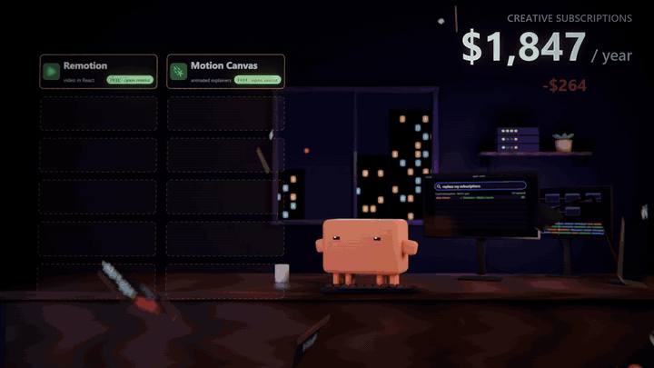

<div align="center">
  
</div>

<br />

<div align="center">
  <a href="https://x.com/m4lkxx">
    
  </a>
  <a href="https://t.me/m4lka4">
    
  </a>
  
</div>

<h3 align="center">i make films with code — and write about the agents that render them.</h3>

<p align="center">
  <samp>motion engineering · claude opus 5.5 · three.js · blender cycles · ffmpeg · long-form on x</samp>
</p>

---

## `01` &nbsp;logline

I'm **m4lka** — writer, AI researcher, dev.

I build short character films and motion packs **without a timeline editor**. A model writes the scene, one clock drives picture and sound, and the frames come out of **three.js** or **Blender Cycles**, stitched with **ffmpeg**.

Then I write about what broke: wrong brand color, a prop clipping through a body, a loop seam that jumps. The interesting part of AI video is not the prompt. It's the checks.

> The model writes the scene. The checks decide if it ships.

## `02` &nbsp;reel

<div align="center">
  
</div>

<p align="center"><sub>every frame above was rendered from code. no after effects, no keyframes dragged by hand.</sub></p>

| Film | What it is |
| :--- | :--- |
| **sub-killer** | 3D room scene in Blender Cycles — a creative-tools bill counting down to $0 |
| **text-12** | 12 text animations people sell as $49 packs, rebuilt one by one |
| **effects-12** · **pt 2** | 24 motion effects that usually cost $500 each, as a single grid film |

## `03` &nbsp;pipeline

```text
brief → beats → one timeline → render → contact sheet → probe → fix → encode → post
```

```text
[ WRITE  ]  BRAND / FORMAT / BEATS / CAMERA / LOOK / ACTING / CHECKS
[ RENDER ]  renderAt(t) in three.js  ·  Blender 5 Python + Cycles
[ SOUND  ]  synthesized from the same timeline, so hits land on frames
[ CHECK  ]  contact sheets, color probes, loop seams, frame bounds
[ SHIP   ]  ffmpeg encode → 16:9 + square → X
```

## `04` &nbsp;what breaks

The stuff an agent gets wrong on the first render, and the check that catches it:

| Symptom | Check |
| :--- | :--- |
| brand orange reads peach after tone mapping | pixel probe against the hex |
| a prop sits inside the character | contact check across every frame |
| the character drifts out of frame | bounds check on the safe area |
| the loop jumps at the seam | first-vs-last frame diff |
| "looks fine" in one still, broken in motion | contact sheet of the whole timeline |

## `05` &nbsp;stack

<div align="center">
  
</div>

<br />

<div align="center">
  
  
  
  
  
</div>

## `06` &nbsp;writing

Long-form on X about agents, harnesses and making video with models — one sentence per line, levels instead of essays, and a "what breaks" at the end of each.

<p>
  <a href="https://x.com/m4lkxx/articles"><strong>→ read the articles</strong></a>
</p>

## `07` &nbsp;next up

```text
[ CUTTING   ]  the check scripts as a repo: probe · contact sheet · seam check
[ WRITING   ]  a defect-first guide to motion with Opus 5.5
[ RENDERING ]  more films, more packs, all from code
```

<details>
  <summary><strong>house rules</strong></summary>
  <br />

```text
01. one clock drives picture and sound
02. never trust a single still
03. probe the color, don't eyeball it
04. render, look at the contact sheet, then fix
05. ship the film, write what broke
```

</details>

---

<p align="center">
  <samp>write the scene → render the frames → check every one → ship</samp>
</p>

<p align="center">
  <sub>independent work — not affiliated with Anthropic or any tool named above.</sub>
</p>
